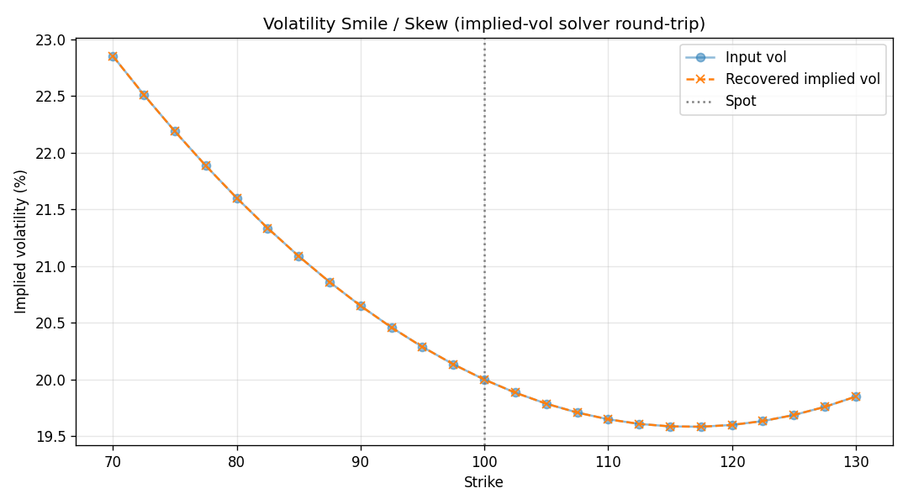
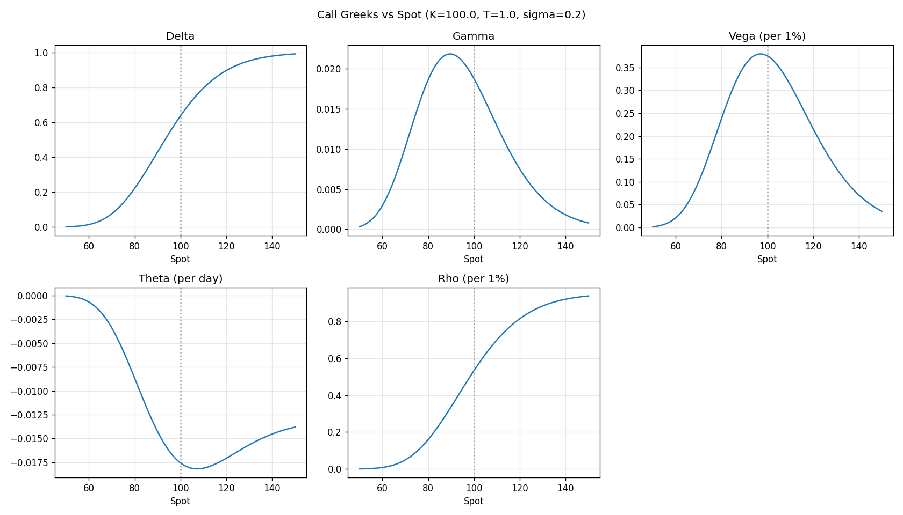

# Options Pricing Library

[](https://www.python.org/)
[](https://docs.pytest.org/)
[](LICENSE)
[](https://scipy.org/)

A self-contained derivatives-pricing library implementing three independent
pricing methods, full Greeks (analytic **and** finite-difference), and a robust
implied-volatility solver — all cross-validated against each other.

## Features

| Model | File | Handles |
|-------|------|---------|
| **Black-Scholes-Merton** (closed form) | `optpricing/black_scholes.py` | European calls/puts with dividend yield + all 5 analytic Greeks |
| **Cox-Ross-Rubinstein binomial tree** | `optpricing/binomial.py` | European **and American** exercise |
| **Monte Carlo** | `optpricing/monte_carlo.py` | European payoffs with **antithetic variates + control variates** and a standard-error estimate |
| **Finite-difference Greeks** | `optpricing/greeks_fd.py` | Model-agnostic Greeks via central differences |
| **Implied volatility** | `optpricing/implied_vol.py` | **Newton-Raphson** with a **Brent** bracketing fallback |

## The mathematics

### Black-Scholes-Merton

Under the risk-neutral measure the asset follows
`dS = (r − q)S dt + σS dW`. The European call price is

```
C = S·e^(−qT)·N(d₁) − K·e^(−rT)·N(d₂)
d₁ = [ln(S/K) + (r − q + σ²/2)T] / (σ√T)
d₂ = d₁ − σ√T
```

with the put from put-call parity `C − P = S·e^(−qT) − K·e^(−rT)`.

The Greeks are the analytic partials: delta `∂V/∂S`, gamma `∂²V/∂S²`,
vega `∂V/∂σ`, theta `∂V/∂t`, rho `∂V/∂r`.

### Binomial tree (CRR)

`u = e^(σ√Δt)`, `d = 1/u`, risk-neutral `p = (e^((r−q)Δt) − d)/(u − d)`.
Rolling back the tree and taking `max(continuation, intrinsic)` at each node
prices American options; as steps → ∞ the European price → Black-Scholes.

### Monte Carlo

`S_T = S₀·exp((r − q − σ²/2)T + σ√T·Z)`, price =
`e^(−rT)·E[payoff]`. Antithetic variates pair each `Z` with `−Z`; a control
variate uses the known `E[S_T] = S₀e^((r−q)T)` to cut variance further.

## Installation

```bash
pip install -r requirements.txt
```

## Usage

```bash
# Price an ATM 1-year call three ways, print Greeks, recover implied vol, save plots
python example.py --spot 100 --strike 100 --tenor 1 --rate 0.05 --vol 0.2

# American put
python example.py --type put --american
```

Library usage:

```python
from optpricing import black_scholes as bs
from optpricing.binomial import binomial_price
from optpricing.monte_carlo import mc_price
from optpricing.implied_vol import implied_vol

bs.bs_price(100, 100, 1, 0.05, 0.2, option_type="call")   # 10.4506
binomial_price(100, 100, 1, 0.05, 0.2, american=True, option_type="put")
mc_price(100, 100, 1, 0.05, 0.2, n_paths=200_000).price
implied_vol(10.4506, 100, 100, 1, 0.05)                    # 0.20
```

## Sample output

```
--- Prices ---
  Black-Scholes (European)   : 10.4506
  Binomial tree (European)   : 10.4486
  Monte Carlo (European)     : 10.4214 +/- 0.0125

--- Greeks (analytic vs finite-difference) ---
  Greek         Analytic     Finite-diff
  Delta         0.636831        0.636831
  Gamma         0.018762        0.018762
  Vega         37.524035       37.524034
```

The three methods agree to within Monte-Carlo error, and analytic Greeks match
their finite-difference estimates — the core correctness guarantee of the library.

### Plots

| Volatility smile (IV solver round-trip) | Greeks vs spot |
|---|---|
|  |  |

## Testing

```bash
python -m pytest -q      # 22 tests
```

Tests validate: BS textbook values, **put-call parity**, **binomial → BS
convergence**, American-call-without-dividends = European, **MC → BS
convergence** within standard error, that variance reduction lowers the standard
error, analytic-vs-finite-difference Greeks, and implied-vol round-trips across
a range of vols for both calls and puts.

## License

MIT — see [LICENSE](LICENSE).
